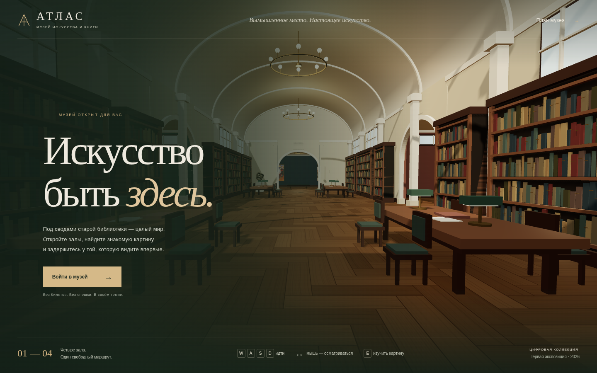

# Атлас — музей искусства и книги

Виртуальный музей в вымышленной старой библиотеке: четыре соединённых зала, свободная прогулка и шесть цифровых репродукций настоящих произведений с русскими описаниями. Архитектура придумана для проекта; сведения об оригиналах и источниках изображений приведены в [ARTWORKS.md](ARTWORKS.md).



## Как открыть музей

Для прогулки достаточно одного файла **`atlas-museum.html`**. Устанавливать программы, запускать сервер или пользоваться командами Git не нужно.

1. На странице репозитория GitHub нажмите на файл `atlas-museum.html`.
2. Справа над содержимым файла нажмите значок скачивания — **Download raw file**. Сохраните файл с расширением `.html`.
3. Найдите скачанный файл на компьютере и откройте двойным щелчком в современном настольном браузере: Chrome, Edge, Firefox или Safari с поддержкой WebGL 2.
4. Нажмите **«Войти в музей»**.

Другой способ скачать: на главной странице репозитория нажмите зелёную кнопку **Code → Download ZIP**, распакуйте архив и откройте находящийся внутри `atlas-museum.html`.

Этот файл содержит код, оформление и изображения: сама прогулка работает без интернета. Интернет нужен только при переходе по внешним ссылкам музеев. `index.html` — исходная страница для разработки; для открытия двойным щелчком используйте именно `atlas-museum.html`.

Изменения проекта можно поручать Codex, включая работу с Git и подготовку коммитов. Для получения обновлённого музея скачайте свежую версию `atlas-museum.html`.

## Управление

| Клавиша / действие | Результат |
| --- | --- |
| **W A S D** или стрелки | Идти вперёд, назад и в стороны |
| **Мышь** | Осматриваться |
| **Shift** во время движения | Идти быстрее |
| **E** рядом с картиной | Открыть изображение и описание |
| **Esc** | Пауза, освобождение курсора или выход из карточки |
| **M** | План музея и переход в выбранный зал |
| **F** | Полноэкранный режим |
| **P** | Сохранить снимок текущего вида |

После входа браузер может захватить курсор для свободного обзора. Если захват недоступен, зажмите левую кнопку мыши и двигайте её. Направление обзора исправлено: движение мыши вправо поворачивает камеру вправо, вверх — поднимает взгляд. Чувствительность регулируется в меню паузы.

## Изображение и производительность

Сглаживание, мягкие тени и разрешение с учётом плотности пикселей экрана включены постоянно. Выбора качества графики и ограничения FPS в меню нет.

Кадры выводятся через `requestAnimationFrame`, без программного ограничения FPS. Реальная частота зависит от видеокарты, сложности сцены, браузера и частоты обновления монитора; отсутствие лимита в коде не означает, что монитор с частотой 60 Гц будет показывать 300 кадров в секунду. В фоновой вкладке и на паузе браузер и приложение сокращают работу.

## Разработка

Нужен современный Node.js с npm. В облачной среде использован Node.js 24. Команды выполняются из папки проекта.

Установить зависимости по зафиксированному lock-файлу:

```sh
npm ci --cache /tmp/atlas-npm-cache
```

Запустить локальный сервер:

```sh
npm start
```

Откройте `http://localhost:4173`. Во время работы сервер оставляют запущенным; остановка — **Ctrl+C** в терминале.

Собрать автономный файл после изменения исходников:

```sh
npm run build
```

Сборка обновляет `atlas-museum.html`, включая изображения и библиотеку Three.js. После изменения исходников для новой автономной версии нужно выполнить эту команду снова.

Запустить проверки движения и столкновений:

```sh
npm test
```

Для браузерных проверок оставьте `npm start` работающим и в другом терминале выполните:

```sh
npm run test:browser
```

Браузерные проверки используют установленный Chromium по пути `/usr/bin/chromium`. Если он установлен в другом месте, укажите путь через переменную окружения `CHROMIUM_PATH`; например, в Linux/macOS:

```sh
CHROMIUM_PATH=/путь/к/chromium npm run test:browser
```

В облачной среде проверены отрисовка WebGL, управление, карточки произведений и автономная сборка через HTTP с блокировкой всех дополнительных сетевых запросов. Открытие через `file://` политика облачного Chromium блокирует, поэтому запуск двойным щелчком в этой среде отдельно не проверен.

## Где что находится

| Файл / папка | Назначение |
| --- | --- |
| `atlas-museum.html` | Готовый музей в одном файле для скачивания и открытия |
| `index.html`, `styles.css` | Интерфейс и оформление |
| `src/app.js` | Запуск приложения, мышь, клавиатура, меню и карточки |
| `src/museum.js` | Трёхмерное здание, свет, мебель и размещение произведений |
| `src/navigation.js` | Движение, направление взгляда и столкновения |
| `src/collection.js` | Список произведений, подписи и русские описания |
| `assets/art/` | Локальные изображения произведений |
| `scripts/` | Подготовка зависимостей, локальный сервер и автономная сборка |
| `tests/` | Проверки навигации и браузерного поведения |
| `ARTWORKS.md` | Происхождение репродукций и примечания о кадрировании исходников |
| `THIRD_PARTY_NOTICES.md` | Сведения о сторонних библиотеках |
| `reference/trinity_long_room_webgl_v2.html` | Исходный загруженный прототип для справки |

В первой экспозиции представлены Ван Гог, Хокусай, Мунк, Тёрнер, Кандинский и Пикабиа. Некоторые доступные репродукции кадрированы; точные оговорки и ссылки приведены в [ARTWORKS.md](ARTWORKS.md).
